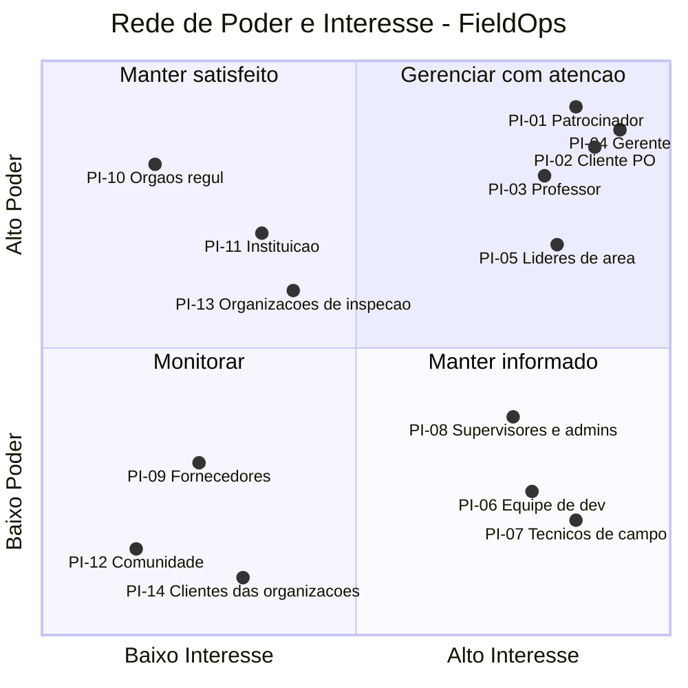

# Rede de Poder/Interesse — Partes Interessadas do Projeto FieldOps

> **Disciplina:** Gestão de Projetos — 4º semestre ADS
> **Professor:** Me. Deivison S. Takatu
> **Aula 08:** Aquisições e Partes Interessadas — Atividade de Partes Interessadas
> **Projeto:** FieldOps — Plataforma de Inspeção em Campo
> **Equipe:** 404 Not Found
> **Data:** 23/10/2026

---

## 1. Objetivo

Este documento apresenta a **matriz de Rede de Poder/Interesse do Projeto FieldOps**, elaborada conforme o processo de **Gerenciamento das Partes Interessadas** (PMBOK, área 13): identificar as partes interessadas, planejar o gerenciamento das partes interessadas, gerenciar o engajamento e controlar o engajamento.

As partes interessadas são classificadas segundo seu **poder** (capacidade de influenciar decisões e recursos do projeto) e seu **interesse** (grau de preocupação com os resultados do projeto), resultando em quatro estratégias de engajamento: **monitorar**, **manter informado**, **manter satisfeito** e **gerenciar com atenção**.

A análise toma como base os artefatos de planejamento já produzidos pela equipe — o TAP (lista de interessados), o organograma, o plano de comunicação, a matriz RACI e o registro de riscos do projeto.

---

## 2. Identificação das Partes Interessadas

Poder e interesse são classificados apenas como **Alto** ou **Baixo**, para que cada parte interessada caia em um único quadrante da matriz.

| # | Parte interessada | Tipo | Poder | Interesse | Quadrante | Principal expectativa |
|---|---|---|:--:|:--:|---|---|
| PI-01 | Fundação Toyota do Brasil (Patrocinador) | Externa | Alto | Alto | Gerenciar com atenção | Retorno do investimento de R$ 204.000,00 e MVP entregue no prazo |
| PI-02 | Cliente / Product Owner | Externa | Alto | Alto | Gerenciar com atenção | Valor entregue e aderência aos requisitos de negócio |
| PI-03 | Professor / Orientador | Externa | Alto | Alto | Gerenciar com atenção | Evolução acadêmica, qualidade e cumprimento das entregas |
| PI-04 | Natália — Gerente de Projeto e Líder Mobile | Interna | Alto | Alto | Gerenciar com atenção | Projeto dentro de prazo, custo e escopo; sucesso do MVP |
| PI-05 | Líderes de área (Marcela — Backend/Nuvem; Júlia — Web/Nuvem) | Interna | Alto | Alto | Gerenciar com atenção | Coordenação técnica e integração entre frentes |
| PI-06 | Equipe de desenvolvimento (Lucas, Andressa, Carol, Ian, Rodrigo, Felipe) | Interna | Baixo | Alto | Manter informado | Tarefas claras, dúvidas resolvidas e entregas concluídas |
| PI-07 | Técnicos de campo (usuários do app) | Externa | Baixo | Alto | Manter informado | App funcional, confiável e com bom uso offline |
| PI-08 | Supervisores de inspeção e administradores (usuários do painel web) | Externa | Baixo | Alto | Manter informado | Painel ágil para cadastro, planejamento, revisão e aprovação de inspeções |
| PI-09 | Fornecedores de nuvem e serviços (AWS, Figma, Expo etc.) | Externa | Baixo | Baixo | Monitorar | Contratação dos serviços e pagamentos em dia |
| PI-10 | Órgãos regulamentadores | Externa | Alto | Baixo | Manter satisfeito | Conformidade legal e de normas de inspeção |
| PI-11 | Instituição de ensino (SENAI) | Externa | Alto | Baixo | Manter satisfeito | Reputação acadêmica e aderência à metodologia PBL |
| PI-12 | Comunidade / demais colegas de turma | Externa | Baixo | Baixo | Monitorar | Acompanhamento do projeto como referência |
| PI-13 | Organizações responsáveis pela execução das inspeções | Externa | Alto | Baixo | Manter satisfeito | Plataforma que padronize e dê rastreabilidade às inspeções |
| PI-14 | Clientes atendidos pelas organizações de inspeção | Externa | Baixo | Baixo | Monitorar | Resultados de inspeção confiáveis e disponibilizados mais rápido |

**Justificativas das classificações que não são óbvias:**
- **PI-05 Líderes de área:** aprovam as entregas das suas frentes na Matriz RACI, por isso têm poder alto.
- **PI-06 e PI-08:** fornecem e usam o resultado, mas não decidem prioridades nem recursos do projeto, por isso o poder é baixo.
- **PI-09 Fornecedores:** há vários fornecedores alternativos para cada serviço (ver Aquisições), então nenhum deles tem poder alto sobre o projeto.
- **PI-11 Instituição de ensino:** define o calendário e as regras de avaliação (por exemplo, a extensão da entrega para 24/11/2026), mas não acompanha o dia a dia; esse acompanhamento é feito pelo professor (PI-03).
- **PI-13 Organizações de inspeção:** decidem se vão adotar a plataforma, mas acompanham o projeto por meio do Cliente/PO (PI-02).

> A Natália aparece apenas em PI-04, que já reúne os papéis de Gerente de Projeto e Líder Mobile.

---

## 3. Matriz de Rede de Poder/Interesse

A matriz cruza **poder** (eixo vertical) com **interesse** (eixo horizontal), definindo a estratégia de engajamento de cada quadrante:

---

## 4. Estratégias de Engajamento por Quadrante

### 4.1 🔴 Gerenciar com atenção (Alto poder · Alto interesse)
> Partes interessadas mais importantes — devem ser plenamente engajadas e satisfeitas.

| Parte interessada | Estratégia de engajamento | Canal |
|---|---|---|
| PI-01 Patrocinador (Fundação Toyota) | Demonstração dos resultados e alinhamento de investimento e prazo | Demonstração ao final de cada sprint, presencial ou Meet |
| PI-02 Cliente / PO | Validação contínua das entregas, priorização do backlog e aprovação do MVP | Relatório de status por e-mail + demo de sprint (Meet) |
| PI-03 Professor / Orientador | Apresentação da evolução e das entregas acadêmicas | Reunião + repositório GitHub |
| PI-04 Gerente de Projeto (Natália) | Condução integral do projeto, coordenação das frentes e das cerimônias | Todos os canais |
| PI-05 Líderes de área (Marcela, Júlia) | Participação nas decisões técnicas, aprovação das entregas da área e alinhamento de integração | Coordenação técnica semanal (Meet/GitHub) + planejamento de sprint |

### 4.2 🟠 Manter satisfeito (Alto poder · Baixo interesse)
> Pouco interesse no dia a dia, mas alto poder — manter satisfeitas sem sobrecarregar com detalhes.

| Parte interessada | Estratégia de engajamento | Canal |
|---|---|---|
| PI-10 Órgãos regulamentadores | Garantir conformidade legal/normativa das inspeções; acionar somente quando necessário | Comunicação formal pontual |
| PI-11 Instituição de ensino (SENAI) | Cumprir o calendário e os critérios de avaliação; manter o repositório organizado para consulta | Entregas da disciplina + repositório |
| PI-13 Organizações de inspeção | Mostrar como a plataforma atende ao processo de inspeção, por meio do Cliente/PO | Comunicado de entrega (e-mail) + demonstrações via Cliente/PO |

### 4.3 🟡 Manter informado (Baixo poder · Alto interesse)
> Muito interessadas, baixo poder — manter bem informadas e engajadas.

| Parte interessada | Estratégia de engajamento | Canal |
|---|---|---|
| PI-06 Equipe de desenvolvimento | Backlog claro, dailies, resolução de dúvidas e revisão de código | WhatsApp + GitHub (Issues/PR) |
| PI-07 Técnicos de campo (usuários) | Coletar feedback de usabilidade do app e do fluxo offline | Testes de campo + sessões de validação por sprint |
| PI-08 Supervisores e administradores | Feedback sobre o painel de cadastro, planejamento, revisão e aprovação | Sessões de validação por sprint + homologação |

### 4.4 🟢 Monitorar (Baixo poder · Baixo interesse)
> Acompanhar com esforço mínimo, sem comunicação intensa.

| Parte interessada | Estratégia de engajamento | Canal |
|---|---|---|
| PI-09 Fornecedores de serviços | Acompanhar contratos, SLA e pagamentos (ligado ao risco R02 e às aquisições) | Portais dos fornecedores |
| PI-12 Comunidade / colegas | Compartilhar resultados ao final, sem comunicação dedicada | Repositório público |
| PI-14 Clientes das organizações | Informar a entrega por meio das organizações de inspeção | Comunicado de entrega (e-mail, via organizações) |

---

## 5. Técnica Analítica — Nível de Engajamento

Classificação do engajamento **atual (C)** e **desejado (D)** das principais partes interessadas, conforme a técnica analítica das partes interessadas (desinformado, resistente, neutro, dá apoio, lidera). Quando o nível atual já é o desejado, a célula mostra **C/D**.

| Parte interessada | Desinformado | Resistente | Neutro | Dá apoio | Lidera |
|---|:--:|:--:|:--:|:--:|:--:|
| PI-01 Patrocinador (Fundação Toyota) | | | | C | D |
| PI-02 Cliente / PO | | | C | D | |
| PI-03 Professor / Orientador | | | | C/D | |
| PI-04 Gerente (Natália) | | | | | C/D |
| PI-05 Líderes de área | | | | | C/D |
| PI-06 Equipe de desenvolvimento | | | | C/D | |
| PI-07 Técnicos de campo | C | | | D | |
| PI-08 Supervisores e administradores | C | | | D | |
| PI-11 Instituição de ensino | | | | C/D | |
| PI-13 Organizações de inspeção | C | | | D | |

> **Legenda:** **C** = engajamento atual · **D** = engajamento desejado. As lacunas (técnicos de campo, supervisores, administradores e organizações ainda desinformados) direcionam ações de engajamento, como sessões de validação, testes de campo e o comunicado de entrega.

---

## 6. Considerações Finais

- Foram identificadas **14 partes interessadas**, incluindo todos os interessados listados no TAP, e posicionadas na **Rede de Poder/Interesse**, resultando em quatro estratégias de engajamento.
- O quadrante **"Gerenciar com atenção"** concentra Patrocinador, Cliente/PO, Professor, Gerente de Projeto e Líderes de área — os atores de maior poder e interesse.
- A matriz está **alinhada ao plano de comunicação do projeto**: cada estratégia reutiliza os canais e frequências ali definidos (demonstração ao patrocinador ao final de cada sprint, relatório de status e demo de sprint ao Cliente/PO, sessões de validação com usuários, coordenação técnica semanal e comunicado de entrega).
- O engajamento dos **fornecedores** conecta-se diretamente ao **gerenciamento das aquisições** e ao risco **R02 (indisponibilidade dos serviços de nuvem de terceiros)** do registro de riscos do projeto.
- Este documento deverá ser **monitorado no processo 13.4 — Controlar o engajamento das partes interessadas**, ajustando a classificação e as estratégias conforme o projeto evolui.
